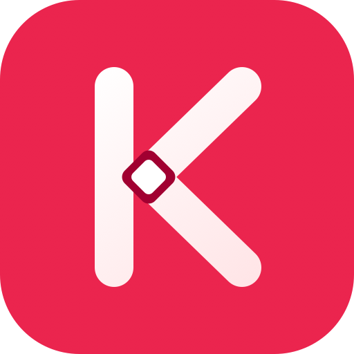
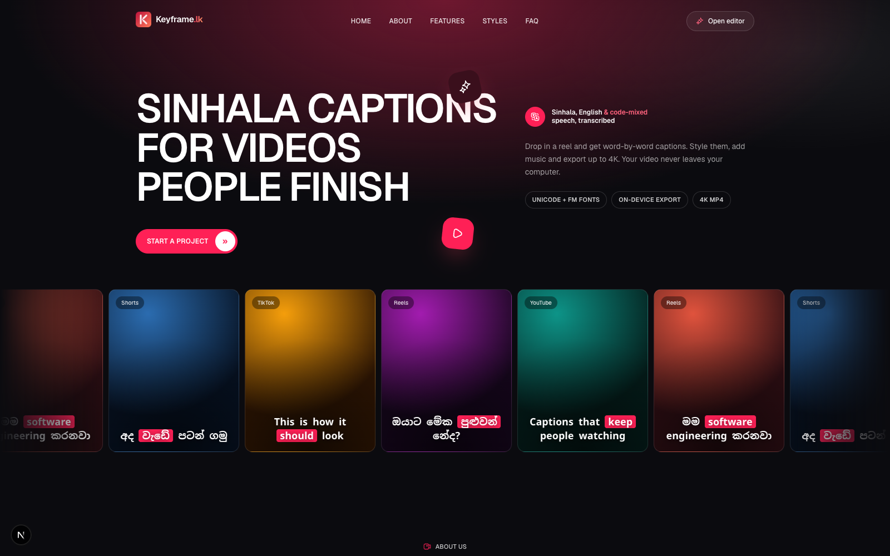
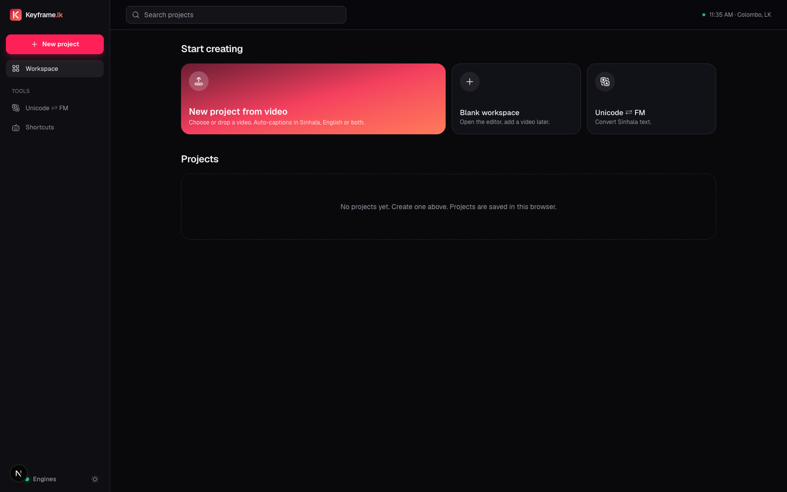
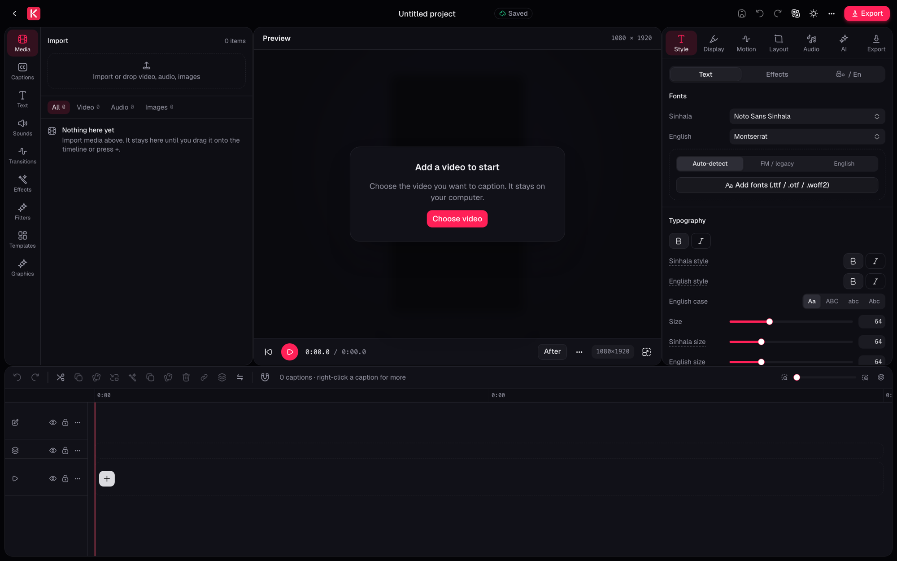

<div align="center">



# Keyframe.lk

**Sinhala auto-captions for short-form video. Style, animate and export in your browser.**

Reels · TikTok · Shorts &nbsp;|&nbsp; සිංහල · English · code-mixed &nbsp;|&nbsp; Unicode + legacy FM fonts

[](https://github.com/elixinnovations/keyframe-web/actions/workflows/ci.yml)


[](LICENSE)

[](https://github.com/elixinnovations/keyframe-web/releases/latest)

[Quick start](#-quick-start) · [Features](#-features) · [Guide](#5-your-first-video-step-by-step) · [Shortcuts](#13-keyboard-shortcuts) · [Troubleshooting](#17-troubleshooting) · [Roadmap](docs/ROADMAP.md)

<br />



</div>

---

## ✨ Features

<table>
<tr>
<td width="50%" valign="top">

### 🎙️ Auto-captions
Word-by-word transcription of Sinhala, English and code-mixed speech ("මම software engineering කරනවා") with Gemini, ElevenLabs Scribe or Whisper. Import SRT / VTT / ASS too.

</td>
<td width="50%" valign="top">

### 🔤 Sinhala-first typography
25 built-in fonts, your own `.ttf/.otf/.woff2`, and legacy **FM fonts**. Text stays Unicode while you edit and is converted to FM only when drawn.

</td>
</tr>
<tr>
<td valign="top">

### 🎨 Templates, styles and motion
Animated caption templates, per-word and per-caption styling, highlight modes, 14 entrance animations, overlays, filters, effects and transitions.

</td>
<td valign="top">

### 🎬 Multi-track timeline
Video, audio, caption, overlay, filter and effect tracks. Split, trim, snap, ripple delete, speed curves, keyframes, multi-select and groups.

</td>
</tr>
<tr>
<td valign="top">

### 🤖 AI tools
Emphasis picking, hook lines, B-roll placement, post descriptions, proofreading and Sinhala-script → English word fixing (Gemini or Claude).

</td>
<td valign="top">

### 🎵 Music and audio
Jamendo library, beat and BPM detection, auto-ducking under speech, voice enhance, RNNoise noise removal, sound effects, LUFS mastering.

</td>
</tr>
<tr>
<td valign="top">

### 🔒 Local-first export
MP4 up to 4K rendered on your device with WebCodecs. Preview and export share one renderer, so what you see is what you get.

</td>
<td valign="top">

### 💸 Cost tracking
A Usage tab logs every paid API request with tokens and estimated cost in USD and LKR.

</td>
</tr>
</table>

## 🖼️ Screenshots

<table>
<tr>
<td width="50%"><p align="center"><b>Projects dashboard</b></p></td>
<td width="50%"><p align="center"><b>Editor: media, preview, inspector and timeline</b></p></td>
</tr>
</table>

## 🧰 Tech stack

<p align="center">
  
</p>

| Layer | Built with |
|---|---|
| Editor (`web/`) | Next.js, React, Zustand, shadcn/ui + Radix, Tailwind CSS, Hugeicons, Mediabunny (WebCodecs) |
| API (`server/`) | Hono on Node, Anthropic SDK, Gemini / ElevenLabs / OpenAI, ffmpeg |
| Sinhala service (`python/`) | FastAPI, uv, fontTools, Pillow |
| Desktop (`desktop/`) | Electron + electron-builder (macOS dmg) |

## 🚀 Quick start

```bash
git clone https://github.com/elixinnovations/keyframe-web.git keyframe
cd keyframe
npm run setup      # web + server packages, Python deps, server/.env
# add GEMINI_API_KEY to server/.env
npm run dev        # open http://localhost:5180
```

The full guide follows.

---

## 📚 Contents

1. [What you need](#1-what-you-need)
2. [Install](#2-install)
3. [Add your API keys](#3-add-your-api-keys)
4. [Start the app](#4-start-the-app)
5. [Your first video, step by step](#5-your-first-video-step-by-step)
6. [Editing captions](#6-editing-captions)
7. [Styling](#7-styling)
8. [English words written in Sinhala letters](#8-english-words-written-in-sinhala-letters)
9. [AI tools](#9-ai-tools)
10. [Music & audio](#10-music--audio)
11. [Export](#11-export)
12. [API usage & cost](#12-api-usage--cost)
13. [Keyboard shortcuts](#13-keyboard-shortcuts)
14. [Sinhala / FM service (Python)](#14-sinhala--fm-service-python)
15. [Project layout](#15-project-layout)
16. [Scripts reference](#16-scripts-reference)
17. [Troubleshooting](#17-troubleshooting)
18. [Known limits](#18-known-limits)
19. [Desktop app](#19-desktop-app)
20. [Contributing](#20-contributing)

---

## 1. What you need

| Tool | Version | Why | Install (macOS) |
|---|---|---|---|
| **Node.js** | 20 or newer | Web editor + API server | `brew install node` |
| **uv** | any recent | Runs the Python Sinhala/FM service | `brew install uv` |
| **Python** | 3.12+ | uv installs it for you if missing | — |
| **ffmpeg** | any recent | Extracts audio from your video before transcription | `brew install ffmpeg` |
| **Chrome / Edge** | recent | MP4 export uses WebCodecs | — |

Windows / Linux: install the same tools from their websites or your package manager. Safari and Firefox can edit, but MP4 export needs a Chromium browser.

## 2. Install

```bash
git clone https://github.com/elixinnovations/keyframe-web.git keyframe
cd keyframe

npm run setup          # installs web + server packages, Python deps, and creates server/.env
npm run fonts:fetch    # optional: downloads free legacy FM / Tharu fonts into web/public/fonts/fm
```

`npm run setup` copies `server/.env.example` to `server/.env` if it doesn't exist yet. It never overwrites your keys.

## 3. Add your API keys

Open `server/.env` and fill in what you have. **You need at least one transcription key** to auto-generate captions. Without any keys you can still import SRT/VTT/ASS files, style and export.

| Variable | What it's for | Where to get it |
|---|---|---|
| `GEMINI_API_KEY` | **Recommended.** Transcription + all AI features. Cheap and good at code-mixed Sinhala. Has a free tier. | [aistudio.google.com/apikey](https://aistudio.google.com/apikey) |
| `ELEVENLABS_API_KEY` | Transcription with ElevenLabs Scribe (very accurate Sinhala). Used first when set. | elevenlabs.io → Profile → API keys |
| `OPENAI_API_KEY` | Transcription fallback (Whisper). Weaker on Sinhala. | platform.openai.com/api-keys |
| `ANTHROPIC_API_KEY` | AI features via Claude instead of Gemini. | console.anthropic.com |
| `JAMENDO_CLIENT_ID` | Free in-app music library (Creative Commons). | devportal.jamendo.com |

Optional settings:

| Variable | Default | Meaning |
|---|---|---|
| `GEMINI_MODEL` | `gemini-2.5-flash` | Model used for transcription |
| `GEMINI_AI_MODEL` | `gemini-2.5-flash` | Model used for AI features when Claude isn't set |
| `ELEVENLABS_MODEL` | `scribe_v1` | ElevenLabs speech-to-text model |
| `FFMPEG_PATH` / `FFPROBE_PATH` | from `PATH` | Point to specific ffmpeg binaries |
| `PORT` | `8787` | API server port |

> `server/.env` is git-ignored. Never commit real keys.

## 4. Start the app

```bash
npm run dev
```

This starts three things together:

| Service | Address | What it does |
|---|---|---|
| Web (Next.js) | **http://localhost:5180** ← landing page, editor at **/editor** | The app |
| API server (Node/Hono) | http://localhost:8787 | Transcription, AI, music, usage log |
| Sinhala service (Python/FastAPI) | http://localhost:8788 | Unicode ⇄ FM conversion, audio analysis |

Stop everything with `Ctrl+C`.

**Production build** (one server for everything):

```bash
npm run build
npm start              # editor + API on http://localhost:8787
```

## 5. Your first video, step by step

1. **Open http://localhost:5180** and click **Import a video**. It's linked from your disk, not uploaded anywhere except to the transcription API.
2. Go to the **Captions** tab (the first icon on the left).
3. Under **Auto-generate**, choose the spoken language (**සිංහල / English / Auto**) and an engine, then click **Generate captions**. A 2-minute video takes about 30–60 seconds.
4. Fix any wrong words by clicking into a caption's text and typing. Press **Enter** to save.
5. Click **English words → Word list only** to turn English words that came out in Sinhala letters (සොෆ්ට්වෙයාර්) into English (software). See [section 8](#8-english-words-written-in-sinhala-letters).
6. Open **Templates** and click a look you like, e.g. *Clean Pop* or *Fire Emphasis*.
7. Fine-tune in **Style**, **Display** and **Motion**.
8. Press **Space** to preview. Drag captions on the video to move them.
9. Go to **Export**, pick a resolution and click **Export MP4**.

Your project autosaves in the browser (IndexedDB). You can close the tab and come back.

## 6. Editing captions

Everything here is in the **Captions** tab.

**Text**
- Click a caption's text box to edit. **Enter** saves.
- The small play button replays just that caption; the bin deletes it.
- **Add** inserts a caption at the playhead. **Find / Replace** fixes a word everywhere.
- **Proofread** (AI) fixes typical speech-recognition spelling mistakes.

**Caption length**: max words, max characters, max duration and "break on pause". Changing these regroups captions without losing your text edits or word styles. It *does* reset per-caption position/font overrides (below).

**Per-word styling**: click the word chips under a caption (Shift-click for a range, ⌘-click to add). The word toolbar lets you change:
- size (− / + / click % to reset), color, bold, **Emphasis**
- **Font** for just those words
- **Case** for English words: `Auto` / `Aa` as typed / `ABC` capitals / `abc` simple / `Abc` Title
- **To English** for Sinhala-script words ([section 8](#8-english-words-written-in-sinhala-letters))

**Per-caption styling**: click a caption row to select it. A **This caption** box appears:
- **Position**: Auto / Top / Middle / Bottom, plus Horizontal and Vertical sliders
- **Size**: font size for this caption only
- **Sinhala font / English font**: or "Project font" to follow the global style
- **English case**: Auto / Aa / ABC / abc / Abc
- **Use project style** removes all overrides from that caption

**Moving captions on the video**
- Drag a caption in the preview → moves **all** captions (the project layout).
- Select a caption first (or one that already has its own position), then drag → moves **only that caption**.
- Captions snap to the horizontal center; a yellow line shows when centered.

**Timeline** (bottom): drag captions to move them, drag edges to trim, zoom with the slider. **S** splits at the playhead, **M** merges with the next caption.

## 7. Styling

| Tab | What you control |
|---|---|
| **Templates** | 14 built-in looks with animated previews. Save your own; import/export as JSON. |
| **Style** | Sinhala + English fonts, bold/italic, **English case** (Aa / ABC / abc / Abc), size, letter/word spacing, line height, opacity, color or gradient, stroke, shadow presets, glow, background plate. The "සිං / En" tab gives each script its own overrides. |
| **Display** | How words appear: natural, highlight active word, box highlight, word by word, word appear, compact emphasis. Words per chunk, highlight colors, emphasis color/scale/font. |
| **Motion** | 14 entrance animations for captions and words, plus speed. |
| **Layout** | Caption position, max width, alignment, canvas and blur fill. Aspect ratio is also under the preview. |

**Fonts**: 25 built-in fonts, plus your own `.ttf/.otf/.woff2` (Style → Fonts → Import). Legacy **FM fonts** work too: text stays Unicode in the editor and is converted to FM encoding only when drawn. Turn on **Safe zones** under the preview to avoid the TikTok/Reels UI.

The preview and the export use the same renderer, so what you see is exactly what you get.

## 8. English words written in Sinhala letters

Speech recognition often writes English words in Sinhala script: සොෆ්ට්වෙයාර් ඉන්ජිනියරින් බේසික්ස්. The **English words** button (Transcript header), **To English** (per caption, and in the word toolbar) fix this. Each has two choices:

| Option | Cost | What it does |
|---|---|---|
| **Word list only** | Free, offline, instant | Converts ~130 common words (software, engineering, program, industry, course, AI, IT…). |
| **Word list + AI** | ≈ $0.0001 per caption | Runs the free list first, then sends only the remaining captions to the AI, which figures out every English word from context. Real Sinhala words are never touched. |

Result: `Generative AI, software engineering basics අපි companyට`. Undo the whole conversion with **⌘Z**.

Add your own words to the free list in [`web/src/lib/english-words.ts`](web/src/lib/english-words.ts):

```ts
['software', ['සොෆ්ට්වෙයාර්', 'සොෆ්ට්වෙයර්']],   // English, [Sinhala spellings…]
```

After converting, use **English case** (Style tab, per caption, or per word) to show them as `SOFTWARE`, `software` or `Software`.

## 9. AI tools

The **AI** tab (needs `GEMINI_API_KEY` or `ANTHROPIC_API_KEY`):

- **Emphasis**: picks the key words to highlight. Works offline too (simple heuristic) when no AI key is set.
- **Hook**: suggests an attention-grabbing opening line and places it on the video.
- **B-roll**: add your photos; the AI places them where they fit the speech.
- **Description**: post title, description and hashtags.

Plus **Proofread** and **English words** in the Captions tab.

## 10. Music & audio

- **Tracks**: add music from your files or the Jamendo library (`JAMENDO_CLIENT_ID`). Per-track volume, fade in/out, loop, intro skip, "Fit to video"; drag and trim on the timeline.
- **Analysis**: the Python service detects tempo (BPM) and beats; the browser measures loudness (LUFS) and draws the waveform.
- **Auto-ducking**: music dips under speech, using the caption timings. Adjustable amount, attack and release.
- **Voice**: volume, mute, and an "Enhance voice" chain (high-pass, presence EQ, compressor).
- **Sound effects**: 8 generated effects (pop, whoosh, riser…) triggered by words, emphasis, new captions or the hook.
- **Mastering**: export is normalized to −14 / −16 / −23 LUFS with a −1 dBFS limiter.

## 11. Export

The **Export** tab:

- **MP4** up to 4K, rendered on your device with WebCodecs (Chrome/Edge). Keeps original audio plus your music mix.
- **Subtitles**: SRT (Unicode or legacy FM), VTT, styled ASS, TXT.

Keep the tab open and in front while exporting; background tabs are throttled by the browser.

## 12. API usage & cost

The **Usage** tab (coins icon, last in the sidebar) shows every paid API request the server has made:

- **Totals**: number of requests, failed requests, estimated cost in USD and LKR, today's cost, tokens
- **By feature**: Generate captions, Proofread, English words, Emphasis, Hook…
- **By day**: last 14 days
- **Recent requests**: time, model, tokens and cost for each call
- **Prices used** and a **Reset usage log** button

The log is saved in `server/data/usage.json` (git-ignored) and survives restarts. It's also available as JSON at `GET http://localhost:8787/api/usage` (`DELETE` resets it).

**Typical costs** with Gemini 2.5 Flash (estimates from list prices, USD):

| Action | 2-minute video |
|---|---|
| Generate captions | ≈ $0.005 |
| Proofread / English words (whole video) | ≈ $0.001 |
| One caption "To English" | ≈ $0.0001 |
| Word list only | free |

These are estimates. Google's free tier can make the real bill $0; check [AI Studio → Usage](https://aistudio.google.com) or your provider's billing page for exact numbers. Prices live in `server/src/usage.ts` if you need to update them.

## 13. Keyboard shortcuts

| Key | Action |
|---|---|
| **Space** | Play / pause |
| **← / →** | Back / forward one frame |
| **⇧← / ⇧→** | Back / forward 1 second |
| **⌥← / ⌥→** | Nudge selected caption ±30 ms |
| **S** | Split caption at playhead |
| **M** | Merge selected caption with next |
| **Del** | Delete selected caption |
| **⌘Z / ⇧⌘Z** | Undo / redo |
| **1 – 9** | Switch side panel (Usage has no number, click its icon) |
| **⌘K** | Unicode ⇄ FM converter |
| **⌘ + scroll** | Zoom timeline |
| **?** | Show all shortcuts |


## 14. Sinhala / FM service (Python)

`python/` is a uv project (FastAPI) that owns the Unicode ⇄ FM mapping.

- **One mapping file**: `keyframe_sinhala/table.py` is the source. It writes `web/src/lib/fm-table.json`, which the browser converter and the Wijesekara keyboard read, so they can't drift apart.
- **Checked against real fonts**: `npm run fm:verify` checks the table against the FM font files (fontTools + Pillow rendering) and writes `python/reports/fm-verify.html`.
- **Tests**: `npm run test:py` (Python) and `npm run test:parity` (TypeScript and Python agree).
- **API**: `/api/sinhala/*` converts text and SRT files, lists fonts, and turns Wijesekara keystrokes into Unicode.

The bundled FM / Tharu fonts are free downloads without clear licence terms. They are flagged in the font picker and are not committed to git (`npm run fonts:fetch` downloads them).

## 15. Project layout

```
keyframe/
├── web/                      React + Next.js editor
│   ├── src/render/           caption renderer + frame compositor (shared by preview and export)
│   ├── src/lib/              segmentation, FM converter, SRT/ASS, IndexedDB, exporter, API client,
│   │                         english-words.ts (free Sinhala-script → English list)
│   ├── src/audio/            mix graph, loudness, sound effects, audio render
│   └── src/components/       UI on shadcn/ui + Hugeicons (panels, preview, timeline, converter)
├── desktop/                  Electron wrapper (macOS app)
├── server/                   Hono API on Node
│   ├── src/transcribe.ts     ffmpeg → Gemini / ElevenLabs / Whisper
│   ├── src/ai.ts             AI features (Claude or Gemini)
│   ├── src/usage.ts          request + cost log
│   ├── src/music.ts          Jamendo library proxy
│   ├── .env.example          key template (copy to .env)
│   └── data/                 usage log (git-ignored)
└── python/                   FM table, converter, font verification, audio analysis (FastAPI)
```

## 16. Scripts reference

Run from the repo root:

| Command | What it does |
|---|---|
| `npm run setup` | Install everything and create `server/.env` |
| `npm run dev` | Start editor + API + Python service |
| `npm run build` | Build the editor into `web/dist` |
| `npm start` | Serve the built editor + API on :8787 |
| `npm run typecheck` | TypeScript check for web and server |
| `npm run fonts:fetch` | Download the legacy FM / Tharu fonts |
| `npm run fm:table` | Regenerate `fm-table.json` from the Python table |
| `npm run fm:verify` | Verify the FM table against real fonts (HTML report) |
| `npm run test:py` | Python tests |
| `npm run test:parity` | TypeScript ⇄ Python converter parity test |

## 17. Troubleshooting

| Problem | Fix |
|---|---|
| "The caption server is offline" | The API isn't running. Start with `npm run dev` and check the terminal for errors. |
| "No engine key" / Generate is disabled | Add `GEMINI_API_KEY` (or another transcription key) to `server/.env`. The server reloads automatically. |
| Transcription fails with an ffmpeg error | Install ffmpeg (`brew install ffmpeg`) or set `FFMPEG_PATH` in `server/.env`. |
| "Gemini rate limit reached" | Free-tier limit hit. Wait a minute, or enable billing in Google AI Studio. |
| AI features say they need a key | Add `GEMINI_API_KEY` or `ANTHROPIC_API_KEY`. |
| "This project's video is missing" | Click **Re-attach video** and pick the same file. Captions and styles are kept. |
| MP4 export button disabled / fails | Use Chrome or Edge. Keep the tab visible during export. |
| FM fonts missing from the font list | Run `npm run fonts:fetch`. |
| Port 5180 / 8787 / 8788 in use | Stop the old `npm run dev` (or change `PORT` in `server/.env`). |
| Usage tab shows nothing | Only requests made since the usage log was added are counted. Make one AI request and refresh. |

## 18. Known limits

- The FM mapping table follows the common open-source converter layout. A few rare ligatures (repaya `¾`, some `ු/ූ` forms) may differ in specific FM fonts. The table is data-driven and easy to correct.
- Word-appear sound effects are not implemented.
- Cost figures are estimates from list prices, not your actual bill.
- Re-segmenting (changing Caption length) resets per-caption position/font overrides.

## 19. Desktop app

`desktop/` wraps the built editor and API in an Electron app for macOS (Apple silicon).

### Download

Get **`Keyframe-<version>-arm64.dmg`** from the [latest release](https://github.com/elixinnovations/keyframe-web/releases/latest), open it and drag **Keyframe** into Applications.

The app is not signed yet, so macOS blocks the first launch. Right-click **Keyframe** in Applications → **Open** → **Open**, or run:

```bash
xattr -dr com.apple.quarantine /Applications/Keyframe.app
```

### Build it yourself

```bash
cd desktop
npm install
npm start          # run in Electron
npm run dist       # build the app and a .dmg into desktop/dist
```

## License

Copyright © 2026 Elix Innovations (Pvt) Ltd ([elix.lk](https://elix.lk)). All rights not granted by the license are reserved.

Keyframe.lk is released under the [PolyForm Noncommercial License 1.0.0](LICENSE). You may use, change and share it for personal and other non-commercial purposes. **Commercial use requires a separate license** from Elix Innovations (Pvt) Ltd; contact us through [elix.lk](https://elix.lk).

Contributions are welcome and are covered by the Contributor License Agreement in [CONTRIBUTING.md](CONTRIBUTING.md#contributor-license-agreement).

The project license does not cover third-party code, fonts or models. Legacy FM / Tharu fonts (`npm run fonts:fetch`) and the forced-aligner model (`npm run align:fetch`) are downloaded separately under their own terms. See [THIRD_PARTY_NOTICES.md](THIRD_PARTY_NOTICES.md) (regenerate with `npm run notices`).

## 20. Contributing

See [CONTRIBUTING.md](CONTRIBUTING.md). By opening a pull request you agree to its [Contributor License Agreement](CONTRIBUTING.md#contributor-license-agreement). Run `npm run typecheck` and `npm run test:py` before opening a PR; CI runs the same. Please also read the [Code of Conduct](CODE_OF_CONDUCT.md) and report vulnerabilities as described in [SECURITY.md](SECURITY.md).

<div align="center">

<br />

Made in Sri Lanka 🇱🇰 for Sinhala creators.

© 2026 Elix Innovations (Pvt) Ltd · [elix.lk](https://elix.lk)

<a href="#keyframelk">↑ Back to top</a>

</div>
